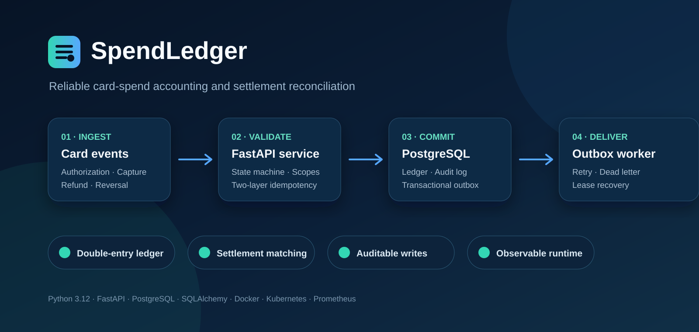
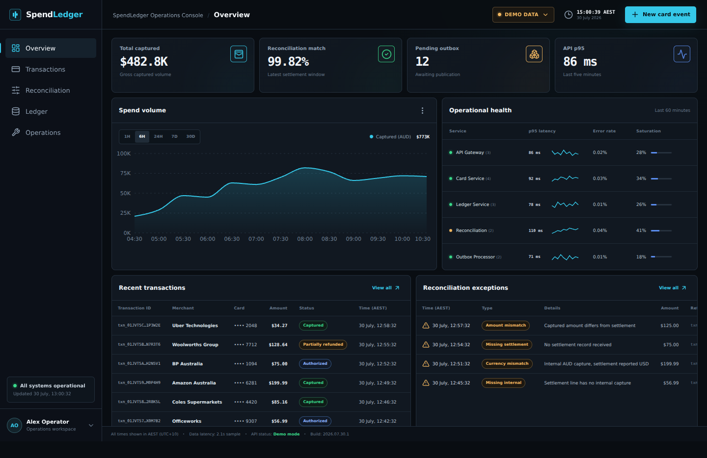
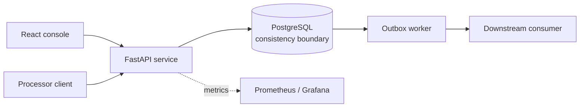
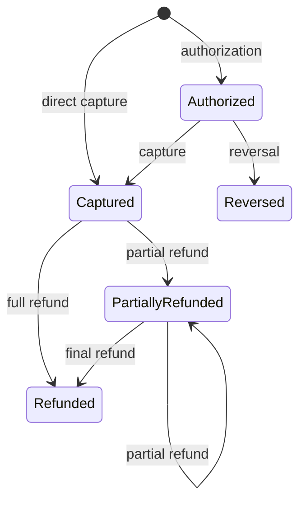

<p align="center">
  
</p>

<h1 align="center">SpendLedger</h1>

<p align="center">
  A production-oriented card-spend platform with an operator console, immutable accounting,
  settlement reconciliation, and reliable event delivery.
</p>

<p align="center">
  <a href="https://github.com/KebingZ/spend-ledger/actions/workflows/ci.yml">
    
  </a>
  
  
  
  
  <a href="LICENSE">
    
  </a>
</p>

SpendLedger accepts card-processor events, enforces a deterministic transaction state machine,
posts balanced double-entry journals, classifies settlement exceptions, and publishes committed
domain events through a transactional outbox.

The project is designed around the failure modes that make financial backends difficult:
duplicate delivery, conflicting retries, concurrent state transitions, partial failures,
accounting integrity, downstream outages, and operational recovery.

<p align="center">
  
</p>

The React Operations Console is a deliberately dense fintech control surface. It runs with
clearly labelled synthetic data for a zero-setup portfolio walkthrough, or connects to the
authenticated FastAPI endpoint to inspect real local transactions, reconciliation exceptions,
ledger postings, outbox state, and runtime health.

Demo mode starts with 24 realistic Australian business transactions across every lifecycle state,
eight reconciliation exceptions, five service-health series, and a populated outbox summary.
`seed_demo.py` also creates 12 real PostgreSQL transactions plus a reconciliation run, so Live API
mode is useful immediately after setup.

## Contents

- [What the system demonstrates](#what-the-system-demonstrates)
- [Operations Console](#operations-console)
- [Architecture](#architecture)
- [Correctness guarantees](#correctness-guarantees)
- [Run it with Docker](#run-it-with-docker)
- [Walk through the card lifecycle](#walk-through-the-card-lifecycle)
- [API surface](#api-surface)
- [Observability and operations](#observability-and-operations)
- [Testing and quality gates](#testing-and-quality-gates)
- [Repository map](#repository-map)
- [Design boundaries](#design-boundaries)

## What the system demonstrates

| Engineering concern | Implementation |
| --- | --- |
| Financial state | Authorization, capture, reversal, partial refund, and full refund state machine |
| Duplicate delivery | HTTP idempotency key plus independent processor-event deduplication |
| Accounting integrity | Immutable double-entry journals using integer minor currency units |
| Atomicity | Transaction, journal, audit record, and outbox event committed together |
| Distributed delivery | Concurrent outbox workers using `FOR UPDATE SKIP LOCKED` |
| Failure recovery | Exponential retry, dead-letter state, and stale worker-lease recovery |
| Settlement operations | Matched, missing, amount-mismatch, and currency-mismatch classification |
| Tenant security | Hashed API keys, tenant isolation, and explicit authorization scopes |
| Production operation | Structured logs, request IDs, metrics, probes, migrations, CI, and Kubernetes |
| Operator experience | Responsive React console with demo/live modes and secure session-only API keys |

## Operations Console

The console is designed for two audiences:

- **Product and recruiting reviewers** can open it in Demo Data mode and understand the system in
  under a minute, without creating credentials or seeding a database.
- **Engineers** can select **Demo Data → Connect API**, enter the local API URL and the one-time
  generated API key, then validate real card events and backend projections.

| Workspace | What it demonstrates |
| --- | --- |
| Overview | Captured volume, reconciliation match rate, outbox backlog, latency, and service health |
| Transactions | Searchable lifecycle projections with status and transaction detail drawers |
| Reconciliation | Exception queue and explicit financial control policies |
| Ledger | Balanced double-entry journals and immutable reference links |
| Operations | Outbox delivery state, service telemetry, retry, lease, and atomicity semantics |

The browser stores a live API key only in `sessionStorage`; it is never hard-coded, committed,
logged, or written into the production bundle. Demo mode is always visibly labelled so synthetic
metrics cannot be mistaken for production telemetry.

## Architecture



A card-event request performs the following work in one PostgreSQL transaction:

1. validates the tenant and API-key scope;
2. checks request-level and provider-event idempotency;
3. locks and transitions the spend transaction;
4. posts a balanced journal when money is captured or refunded;
5. appends an audit record;
6. appends a domain event to the outbox;
7. commits the response and its idempotency record.

The worker publishes only committed outbox rows. Delivery is **at least once**, so downstream
consumers must deduplicate using the outbox event ID.

For the full reasoning, see [Architecture and design decisions](docs/architecture.md).

## Correctness guarantees

### Transaction lifecycle



Invalid transitions return a typed `422` response without leaving partial database writes.
PostgreSQL row-level locking serializes concurrent transitions for the same transaction.

### Financial invariants

- Monetary values are positive integer minor units; floating-point input is rejected.
- A capture cannot exceed its authorization.
- Cumulative refunds cannot exceed the captured amount.
- Every journal has positive and equal debit and credit totals.
- Posted journals are append-only; refunds create reversing journals.
- Tenant ID is included in every externally addressed query.
- Reusing an idempotency key or processor-event ID with a changed payload returns `409`.

Example capture journal for **129.90 AUD**:

| Account | Debit | Credit |
| --- | ---: | ---: |
| Employee expense clearing | 129.90 AUD | |
| Card payable | | 129.90 AUD |

See [Accounting model](docs/accounting-model.md) for capture and refund postings.

## Run it with Docker

### Prerequisites

- Docker Desktop with the Linux engine running
- Docker Compose v2
- Git
- Python 3.12 only if you want to run the demo script from the host

Confirm Docker is ready before continuing:

```powershell
docker version
docker compose version
```

If `docker version` cannot connect to `dockerDesktopLinuxEngine`, start Docker Desktop, wait until
the engine reports **Running**, and then retry.

### Windows PowerShell

From the repository root:

```powershell
Copy-Item .env.example .env
docker compose up -d postgres
docker compose run --rm api alembic upgrade head
docker compose run --rm api python scripts/seed_demo.py
```

The seed command prints a new API key once:

```text
Sample transactions created: 12
Sample reconciliation created: True
Demo API key (shown once):
sl_live_...
```

Start the API, outbox worker, and Operations Console:

```powershell
docker compose up --build api worker frontend
```

Open the console at <http://localhost:3001>. It starts in safe Demo Data mode. To use real data,
select **Demo Data → Connect API** and enter:

```text
API base URL: http://localhost:8000
API key:      sl_live_... (printed by seed_demo.py)
```

Keep that terminal open. To run the command-line lifecycle demo as well, use a second PowerShell
window:

```powershell
$env:SPENDLEDGER_API_KEY = "sl_live_your_generated_key"
python scripts/run_demo.py
```

Open:

- Swagger UI: <http://localhost:8000/docs>
- Operations Console: <http://localhost:3001>
- Readiness: <http://localhost:8000/health/ready>
- Prometheus metrics: <http://localhost:8000/metrics>

### macOS or Linux

```bash
cp .env.example .env
docker compose up -d postgres
docker compose run --rm api alembic upgrade head
docker compose run --rm api python scripts/seed_demo.py
docker compose up --build api worker frontend
```

In another terminal:

```bash
export SPENDLEDGER_API_KEY="sl_live_your_generated_key"
python scripts/run_demo.py
```

### Frontend-only portfolio preview

The polished UI can be reviewed without Docker or a backend:

```bash
cd frontend
npm ci
npm run dev
```

Open <http://localhost:5173>. The console defaults to labelled synthetic demo data. A local live
API can still be connected from the data-source control in the top bar.

### Stop the environment

```powershell
docker compose down
```

To also delete the local PostgreSQL volume and its development data:

```powershell
docker compose down -v
```

The `-v` command is destructive; use it only when you intentionally want a clean database.

## Walk through the card lifecycle

The included demo uses unique identifiers on every run and exercises:

1. authorization;
2. capture and double-entry posting;
3. safe replay using the same idempotency key;
4. partial refund and reversing journal;
5. transaction projection retrieval;
6. immutable capture-journal retrieval.

Run:

```powershell
python scripts/run_demo.py
```

To create a short GitHub demo, record this command together with Swagger UI and save the final
animation as `docs/assets/demo.gif`. Then place this Markdown below the cover image:

```markdown

```

Keep the GIF under approximately 10 MB, crop out unrelated desktop content, and never record the
generated API key.

## API surface

| Method | Endpoint | Scope | Purpose |
| --- | --- | --- | --- |
| `GET` | `/health/live` | Public | Process liveness |
| `GET` | `/health/ready` | Public | Database dependency readiness |
| `GET` | `/metrics` | Public | Prometheus exposition |
| `GET` | `/v1/console/overview` | `spend:read` | Read the console projection |
| `POST` | `/v1/card-events` | `spend:write` | Apply a processor event |
| `GET` | `/v1/transactions/{id}` | `spend:read` | Read transaction state |
| `GET` | `/v1/journals/{reference}` | `ledger:read` | Read immutable journal entries |
| `POST` | `/v1/reconciliations` | `reconciliation:write` | Match a settlement batch |
| `GET` | `/v1/reconciliations/{id}` | `reconciliation:read` | Read reconciliation results |

All protected requests use:

```http
Authorization: Bearer sl_live_...
```

All write requests also require:

```http
Idempotency-Key: a-stable-client-generated-key
```

Errors follow an RFC 7807-style problem-details shape containing a stable code and request ID.

## Settlement reconciliation

The reconciliation service compares an external settlement batch against captured internal
transactions inside a defined time window.

| Result | Meaning |
| --- | --- |
| `matched` | Amount and currency agree |
| `missing_internal` | Settlement line has no captured internal transaction |
| `missing_settlement` | Internal capture is absent from the settlement batch |
| `amount_mismatch` | Transaction exists but amounts differ |
| `currency_mismatch` | Transaction exists but currencies differ |

Every run and exception is persisted for investigation and auditing.

## Observability and operations

Start Prometheus and Grafana with the monitoring profile:

```powershell
docker compose --profile monitoring up --build
```

- Prometheus: <http://localhost:9090>
- Grafana: <http://localhost:3000>

The repository provisions a Grafana dashboard for:

- request rate by route and status;
- p95 request latency;
- processed card events;
- reconciliation exceptions.

The API emits bounded route templates rather than raw transaction IDs as metric labels, preventing
high-cardinality time series. Incoming `X-Request-ID` values are propagated to responses and
structured logs.

Kubernetes examples include:

- separate API and worker deployments;
- readiness and liveness probes;
- resource requests and limits;
- HorizontalPodAutoscaler and PodDisruptionBudget;
- a dedicated migration Job;
- an explicit example network policy;
- managed-secret integration points.

See [Kubernetes deployment](k8s/README.md) and
[Failure modes and operational response](docs/failure-modes.md).

## Testing and quality gates

The current suite contains **29 passing backend tests** and enforces **85% branch coverage**.

```powershell
ruff format --check src tests scripts migrations
ruff check src tests scripts migrations
mypy src
pytest --cov=spendledger --cov-report=term-missing
cd frontend
npm ci
npm run lint
npm run build
```

Tests cover:

- valid and invalid state transitions;
- direct capture, reversal, partial refund, and full refund;
- over-capture and over-refund rejection;
- request and processor-event idempotency conflicts;
- balanced capture and refund journals;
- tenant authentication and scope enforcement;
- every reconciliation result;
- outbox claim, retry, publish, dead-letter, and stale-lock recovery;
- session commit and rollback;
- health, request ID, and metric-label behaviour.
- authenticated console aggregation and CORS policy behaviour.

GitHub Actions runs Python formatting, linting, strict type checking, migration drift detection,
tests, coverage, frontend ESLint and TypeScript builds, and a backend container build on every pull
request. A semantic version tag such as `v1.0.0` publishes the API image to GitHub Container
Registry.

## Repository map

| Path | Responsibility |
| --- | --- |
| `src/spendledger/api.py` | REST boundary, dependencies, idempotent writes, and problem responses |
| `src/spendledger/transactions.py` | Card-event state machine and concurrency control |
| `src/spendledger/ledger.py` | Double-entry journal creation and immutable reads |
| `src/spendledger/reconciliation.py` | Settlement matching and exception classification |
| `src/spendledger/outbox.py` | Concurrent claiming, retry, dead letter, and lease recovery |
| `src/spendledger/security.py` | API-key generation, hashing, authentication, and scopes |
| `src/spendledger/observability.py` | Structured logging, request context, and Prometheus metrics |
| `src/spendledger/console.py` | Authenticated, tenant-scoped console aggregation |
| `frontend/` | React, TypeScript, Recharts, responsive UI, and Nginx image |
| `migrations/` | Alembic schema history |
| `tests/` | Domain, API, failure-path, and worker tests |
| `ops/` | Prometheus and Grafana configuration |
| `k8s/` | Production-oriented Kubernetes examples |
| `load/` | k6 workload and performance thresholds |
| `docs/` | Architecture, accounting, failure, and performance decisions |

## Design documentation

- [Architecture and design decisions](docs/architecture.md)
- [Accounting model](docs/accounting-model.md)
- [Failure modes and operational response](docs/failure-modes.md)
- [Performance test plan](docs/performance-testing.md)
- [Security policy](SECURITY.md)
- [Contributing guide](CONTRIBUTING.md)

## Reliability semantics

| Situation | Behaviour |
| --- | --- |
| Same idempotency key and payload | Replay the original status and response body |
| Same idempotency key with changed payload | Reject with `409` |
| Same processor event ID and payload | Do not duplicate ledger or outbox effects |
| Same processor event ID with changed payload | Reject with `409` |
| Capture exceeds authorization | Reject with `422` and roll back |
| Refunds exceed captured amount | Reject with `422` and roll back |
| Downstream publisher fails | Retry with backoff, then move to dead-letter state |
| Worker crashes after claiming an event | Reclaim the event after its lease expires |
| Database is unavailable | Fail readiness so the pod stops receiving traffic |

## Design boundaries

This repository makes its guarantees explicit:

- Outbox delivery is at least once, not exactly once.
- Reconciliation currently expects one settlement line per captured transaction.
- Card-network clearing rules, chargebacks, tax, and FX conversion are outside the current model.
- API keys are appropriate for this service-to-service reference implementation; an enterprise
  deployment would add managed rotation and workload identity.
- PostgreSQL is the write consistency boundary.
- Multi-region active-active ledger writes require a separate ordering and conflict design.
- The project is not PCI DSS certified and must not be used with real cardholder data.

These limits are documented because reliability depends on knowing where every guarantee ends.

## Author

Built by [Steven Zhao](https://github.com/KebingZ).

## License

Released under the [MIT License](LICENSE).
