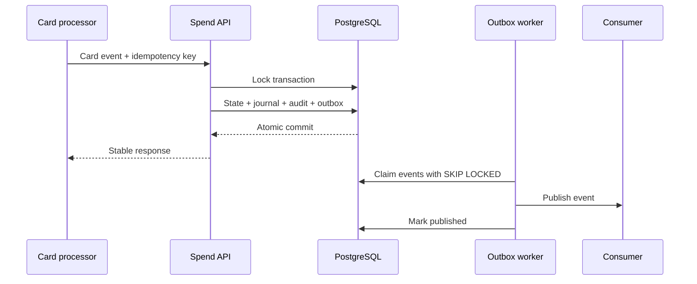
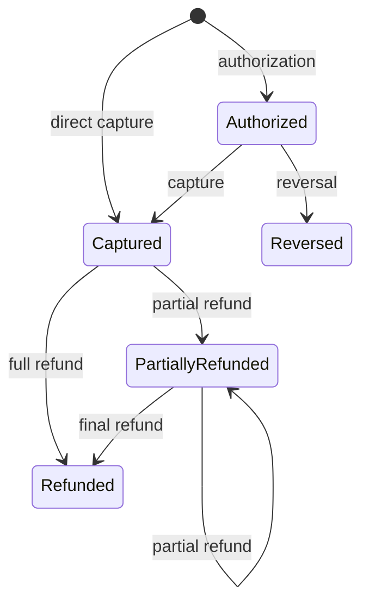

# Architecture and design decisions

## Problem statement

SpendLedger models the accounting boundary between card-processor events and a business customer's
books. It must accept duplicate and out-of-order network traffic without silently creating
duplicate spend, preserve an auditable ledger, identify settlement exceptions, and remain operable
when downstream systems fail.

## Write path

The relational transaction is the consistency boundary. A capture and its journal cannot be
committed without the corresponding audit and outbox records.

## State machine

All other transitions fail with a typed `422` problem response. Row-level locking serializes
concurrent transitions for one transaction in PostgreSQL.

## Data model

| Aggregate | Purpose | Important invariant |
| --- | --- | --- |
| `spend_transactions` | Current spend lifecycle projection | Refund total cannot exceed capture |
| `processor_events` | Provider-event deduplication | Event ID unique inside a tenant |
| `journals` | Immutable accounting header | Positive debits equal credits |
| `ledger_entries` | Debit and credit lines | Amount is a positive integer minor unit |
| `idempotency_records` | Stable API response replay | Key unique per tenant and endpoint |
| `outbox_events` | Reliable downstream hand-off | Publish only after business commit |
| `reconciliation_*` | Settlement matching result | Every exception has an explicit class |
| `audit_logs` | Actor and change history | Append-only application behaviour |

Tenant ID is included in every externally addressed query. API keys store only SHA-256 hashes and
carry explicit scopes.

## Key decisions

### PostgreSQL over an eventually consistent store

The ledger requires multi-row constraints, row locks, and atomic state/journal/outbox writes.
PostgreSQL supplies those properties with a simple operational model. The service can partition by
tenant or settlement date later if volume warrants it.

### Integer minor units

Money enters the service as `amount_minor: 12990` plus `currency: AUD`. No binary floating-point
calculation is permitted. Currency-specific decimal display belongs at an edge or presentation
layer.

### Transactional outbox

Publishing directly after a database write creates a dual-write gap: the process can fail after
one side succeeds. The outbox makes the database commit atomic and moves external delivery into a
retryable worker. Delivery is at least once, so consumers deduplicate with the outbox event ID.

Workers use `FOR UPDATE SKIP LOCKED` to divide batches without a central coordinator. Processing
locks have a lease timeout, allowing a replacement worker to reclaim events after a crash.

### Two idempotency layers

The HTTP idempotency key replays the original response for client retries. The processor event ID
protects the financial domain when the same provider event arrives under a new HTTP request key.
Reusing either identifier with a different payload returns `409`.

## Scaling path

API replicas are stateless and scale horizontally. Worker replicas compete safely for outbox rows.
At higher scale:

1. partition high-volume tables by tenant hash or event date;
2. archive published outbox and old idempotency records under explicit retention policies;
3. route tenant-affine writes to a home region;
4. publish to Kafka with event ID as the deduplication key;
5. add read projections for reporting rather than querying the write ledger.

Multi-region active-active ledger writes are deliberately not claimed here. They require explicit
ordering and conflict semantics, not only more replicas.
